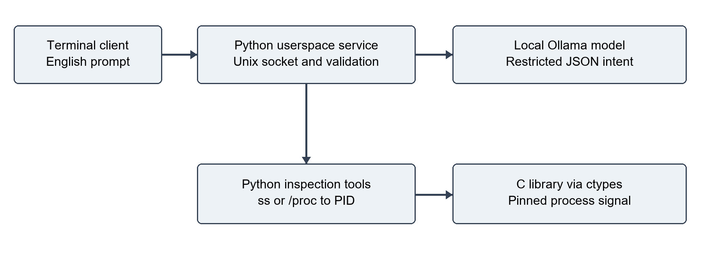

# Port Sentinel Agent

[](https://github.com/RS1321/Port_Sentinel_OS_Project/actions/workflows/ubuntu.yml)

A process-level Ubuntu service with a terminal-only natural-language client. It maps TCP listening sockets and UDP bound sockets to owning processes and can stop a unique process owned by the service user. The LLM returns a restricted JSON intent; it never supplies executable shell text. Python selects fixed `ss` arguments or reads `/proc`, and calls a compiled C library through `ctypes` to signal a pinned Linux process descriptor.

## Current verification

The C library builds successfully on Ubuntu 24.04, and all **29 tests pass with no skips** in [the first Ubuntu validation run](https://github.com/RS1321/Port_Sentinel_OS_Project/actions/runs/39458181805). This includes native TCP discovery and termination, UDP proc fallback, protected-PID rejection and local service transport. Dependency installation and Python syntax checks also passed. The [recorded Ubuntu log](docs/test-results-ubuntu.txt) identifies the tested commit.

On Windows, 25 platform-independent tests passed and 4 Linux tests were skipped. Installed systemd behaviour and real-model English requests remain manual acceptance checks; the Ubuntu automated tests do not run a real model or install the user service. See [the acceptance checklist](docs/UBUNTU_ACCEPTANCE.md) and [latest workflow runs](https://github.com/RS1321/Port_Sentinel_OS_Project/actions/workflows/ubuntu.yml).

## Windows 11 execution video

[Watch or download the Windows 11 demonstration](docs/demos/Port_Sentinel_Windows11_Demo.mp4) (about 75 seconds).

The separate Windows edition passes 20 tests, starts a background user agent, discovers a disposable server on port 8080, stops it through a native C DLL, and verifies that the port is free using both Port Sentinel and `netstat`. The recording displays actual command output through a labelled live-log viewer. It uses explicit commands after the API check returned HTTP 429; successful natural-language inference is not shown. See [recording details](docs/demos/README.md).

## Requirements

Target: Ubuntu 24.04 LTS, Python 3.12, systemd user services, Linux with pidfd support, a C compiler and `iproute2`. Ubuntu 22.04/Python 3.10 is a possible target but has not been verified. Native library operations fail closed if compilation or pidfd support is missing. Ollama and a locally installed model supporting structured output are required for English requests. The default is `qwen3:4b`; model speed and accuracy depend on hardware and model choice.

## Architecture



The diagram shows the terminal client, local Python service, model planner, socket inspection tools and C signalling boundary. See [architecture and request flow](docs/ARCHITECTURE.md) for the implementation details and [the API contract](docs/API.md) for Python integration.

## Reports and documentation

- [Review 1 report PDF](docs/reports/Port_Sentinel_Agent_Review_1_Rahul_Sudarshan.pdf)
- [Review 2 report PDF](docs/reports/Port_Sentinel_Agent_Review_2_with_diagrams.pdf)
- [Editable Review 1 report](docs/Port_Sentinel_Agent_Review_1_Rahul_Sudarshan.docx)
- [Report version notes](docs/reports/README.md)
- [Code review and corrections](docs/CODE_REVIEW.md)
- [Ubuntu acceptance checklist](docs/UBUNTU_ACCEPTANCE.md)

The PDFs are retained as supplied. Review 2 describes the earlier Python-only, multi-turn prototype; the current implementation uses a service, a restricted JSON planner and C integration. The report version notes explain those differences.

## Ubuntu installation

Clone the repository, then run the installation commands from its directory:

```bash
git clone https://github.com/RS1321/Port_Sentinel_OS_Project.git
cd Port_Sentinel_OS_Project
```

The following commands install a per-user copy. The destination is the path expected by the service. Do not run the agent as root.

```bash
sudo apt update
sudo apt install -y python3 python3-venv build-essential iproute2
mkdir -p "$HOME/.local/share/port-sentinel"
cp -a . "$HOME/.local/share/port-sentinel/"
cd "$HOME/.local/share/port-sentinel"
make
python3 -m venv .venv
.venv/bin/python3 -m pip install -r requirements.txt
make test
```

Install Ollama according to [its official Linux guide](https://docs.ollama.com/linux), then start its service and download a model:

```bash
ollama pull qwen3:4b
ollama list
```

Port Sentinel uses only the local Ollama endpoint `http://127.0.0.1:11434`. Model downloads initially need internet access. To validate the model and OS path before installing the service:

```bash
.venv/bin/python3 port_sentinel_agent.py --direct "What process is using port 8080?"
```

## Run as a background service

```bash
mkdir -p "$HOME/.config/systemd/user"
cp systemd/port-sentinel.service "$HOME/.config/systemd/user/"
systemctl --user daemon-reload
systemctl --user enable --now port-sentinel.service
systemctl --user status port-sentinel.service
journalctl --user -u port-sentinel.service -n 30 --no-pager
```

The user service normally follows the user's login session. If it must survive logout and start at boot, an administrator can enable lingering explicitly:

```bash
sudo loginctl enable-linger "$USER"
```

This is a normal userspace daemon, not a kernel module. It creates a mode-0600 Unix socket under a mode-0700 runtime directory and accepts only clients with the same UID. Requests are handled serially, with request-size limits and an Ollama timeout. It exposes no TCP management endpoint, website or graphical UI.

The service uses `PORT_SENTINEL_MODEL=qwen3:4b`. Change it through `systemctl --user edit port-sentinel.service`, adding a `[Service]` section with `Environment=PORT_SENTINEL_MODEL=your-model`, then restart the service. The CLI `--model` option applies to `--direct` mode only.

## Command-prompt demonstration

Start only the supplied disposable server in terminal 1:

```bash
cd "$HOME/.local/share/port-sentinel"
.venv/bin/python3 demo_server.py 8080
```

In terminal 2:

```bash
cd "$HOME/.local/share/port-sentinel"
bash run.sh "What process is using port 8080?"
bash run.sh "What process is hogging port 8080? Stop it."
ss -lntp 'sport = :8080'
```

The inspect request must not terminate the server. The stop request should return the discovered PID, signal and `port_released: true`, and the final `ss` command should show no listener. These are expected outcomes, not recorded Ubuntu results.

Other supported requests:

```bash
bash run.sh "List listening TCP ports"
bash run.sh "Which process owns UDP port 5353?"
bash run.sh "Force kill the process on TCP port 8080"
```

The shell quotes group a prompt into one argument; do not include literal quotation marks inside destructive prompts. Responses are structured terminal JSON containing the interpreted plan and OS results. Numbers must be written as digits, one specific port at a time. Multi-owner stopping, conditional stop instructions, negation and ambiguous wording are refused. There is no automatic escalation from TERM to KILL. Rephrase a refused request as a direct instruction with the port number. English parsing remains model-dependent; deterministic checks deliberately restrict its scope.

## Tests

```bash
make test
python3 test_tools.py
```

Both run the same standard-library unittest suite. Linux integration tests create their own disposable child/socket, verify TCP owner discovery and native SIGTERM release, exercise UDP `/proc` fallback, check PID 1 rejection and test local service transport with a mocked planner. They do not test the real model or a systemd installation. The Ubuntu CI workflow runs build and tests without downloading a model.

Follow `docs/UBUNTU_ACCEPTANCE.md` for the separate manual model/service checks. Do not treat skipped tests or expected output as a completed demonstration.

## Implementation and boundaries

- `port_sentinel_agent.py`: JSON-schema planner, deterministic validation, execution and CLI.
- `port_sentinel_service.py`: same-user Unix socket daemon.
- `port_sentinel_tools.py`: `ss` parsing, `/proc` fallback, process metadata and port verification.
- `native/port_sentinel.c`, `native/port_sentinel.h`: C functions using Linux pidfd system calls.
- `native_bridge.py`: Python/C binding with explicit argument types and errno handling.
- `systemd/port-sentinel.service`: user service and restart configuration.
- `tests/`: regression and Linux integration tests.
- `docs/`: review findings, acceptance checklist, diagrams and Review 1 report.

A stop requires one visible owner, a matching user UID, a matching process start time and a fresh port-owner check. PID 1, PID 2, the service and its parent are protected. The C descriptor pins the process, preventing a later recycled numeric PID from being signalled. Sending a signal is reported separately from observing that the port is free. The target may ignore TERM or a supervisor may restart it; the daemon does not disable other services. A short race remains between the final ownership check and signal delivery if the same process changes its sockets.

Processes owned by other users can have hidden PIDs. Inspection may report a socket with no visible owner; stopping then fails safely. The project does not measure CPU or bandwidth usage, so “hogging” means occupying the requested port. TCP established-only connections, containers in other network namespaces and kernel-level monitoring are outside scope. UDP discovery includes bound sockets; protocol state is reported as provided by `ss` or synthesised by the fallback.

The local socket service is **not MCP**. The template's MCP section is covered as theoretical background and a possible future adapter. The included implementation uses a local JSON request protocol and direct Python operations.

## Repository contents and contribution

Source, native C/header files, tests, service configuration, reports and diagrams are tracked here. Virtual environments, native build products, caches and credentials are excluded. The native library is built on the target Ubuntu machine rather than committed as a platform-specific binary.

See [CONTRIBUTING.md](CONTRIBUTING.md) for validation and change guidance and [CHANGELOG.md](CHANGELOG.md) for the implementation changes. No redistribution licence has been selected; this repository does not grant a separate open-source licence.
