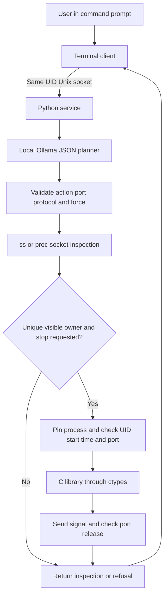
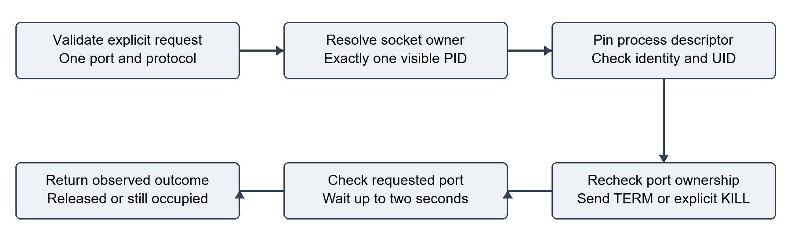

# Architecture

Port Sentinel is a process-level Ubuntu service. It has no graphical interface and does not load kernel modules. The terminal client sends normal English in a JSON request over a local Unix socket.

## Request path

The model supplies a four-field intent, not an executable shell command or a PID. Python derives the candidate PID from live OS inspection. Inspection defaults to TCP; UDP must be requested. Stopping both protocols in one request is refused.

## Components

| File | Responsibility |
| --- | --- |
| `port_sentinel_agent.py` | CLI, model request, intent validation and execution |
| `port_sentinel_service.py` | Unix socket daemon, peer UID check, request framing and error responses |
| `port_sentinel_tools.py` | Socket discovery, PID metadata, identity/ownership checks and release observation |
| `native_bridge.py` | ctypes signatures and errno handling |
| `native/port_sentinel.c` | Linux pidfd open and signal syscalls |
| `native/port_sentinel.h` | Narrow C function declarations |
| `systemd/port-sentinel.service` | Per-user service lifecycle and runtime directory |

## Socket discovery

The `ss` subprocess uses fixed argument lists: TCP `ss -H -lntp`, UDP `ss -H -anup`, and combined `ss -H -antup`. TCP records are retained only in LISTEN state. The parser handles the optional Netid column in combined output. Numeric addresses and PID fields are parsed as data.

If `ss` is unavailable or times out, the agent reads `/proc/net/tcp`, `tcp6`, `udp` and `udp6`, then joins socket inodes against `/proc/PID/fd` symlinks. Missing owner information in individual `ss` rows is supplemented where possible. Unreadable processes remain unresolved; absence of a visible PID is not proof that a socket is unused.

## Process signalling

This diagram shows the checks before a signal and the verification afterwards. A descriptor opened by the C library pins a Linux process instance. Python then checks the process start time, same-user ownership, and fresh port-to-PID mapping. The descriptor is always closed after the signal attempt. A recycled numeric PID cannot redirect the pinned descriptor to a new process.

TERM is the default; KILL requires explicit force wording. The response distinguishes successful signal delivery from an observed free port. A target can ignore TERM or restart through another supervisor. There is no automatic service disabling or escalation.

## Trust and operating limits

The service socket and runtime directory have permissions 0600 and 0700, respectively. Peer credentials must match the service UID. Neither the model nor the service gains administrator privileges. The service protects low system PIDs, itself and its parent; it refuses targets owned by another UID and ambiguous or hidden ownership.

The deterministic English guard is deliberately conservative and is not a general proof of language understanding. It supports one numeric port and direct requests; it rejects conditional or negated stop requests. The model and native library must be installed locally. Socket state can change between the final inspection and signal delivery, even though process identity is pinned.

## MCP status

MCP is not implemented. The included MCP figure describes a possible future adapter, and is labelled as such in the report. The current transport is a project-specific local JSON protocol. Review 2 describes a historical prototype; consult [report version notes](reports/README.md) before comparing its diagrams and listings to this code.
